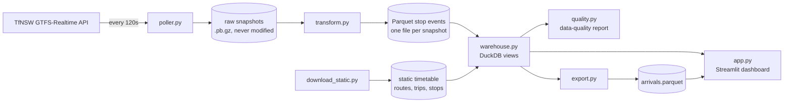

# Sydney bus reliability

How often do Sydney buses turn up on time, and where and when do they fall behind?

This project polls Transport for NSW's live bus feed every two minutes, reduces the arrival predictions to one row per bus arrival, and shows the results in a Streamlit dashboard.

<!-- TODO: dashboard link + screenshot once deployed -->

## Findings

> These numbers are provisional. They come from the first 20 hours of collection (Friday 9 to Saturday 10 October 2026, about 490,000 arrivals) and will be replaced when collection finishes.

About 72% of arrivals are on time, meaning no more than 1 minute early and no more than 5 minutes late. The median bus arrives about a minute behind the timetable.

Late buses are far more common than early ones. With the same 3-minute cut-off on both sides, buses are late about 4 times as often as they are early (23% against 6%). The official window suggests the opposite, 18% early against 11% late, because it counts a bus as early after 1 minute but late only after 5. [Why the on-time window is uneven](#why-the-on-time-window-is-uneven) explains the choice.

<!-- TODO: worst routes, worst hours, weekday vs weekend once there is a full week -->

## How it works



| Step | What it does |
|---|---|
| `poller.py` | Fetches trip updates and vehicle positions every 2 minutes, gzips each response and saves it untouched. Skips snapshots identical to the last one and backs off when the API errors. |
| `transform.py` | Reads each raw snapshot and keeps only the stops a bus will reach within 150 seconds. Writes one Parquet file per snapshot, so reruns only process new data. |
| `warehouse.py` | DuckDB views over the Parquet files: keeps the latest prediction for each trip and stop, then joins route, direction and stop names from the static timetable. |
| `app.py` | Streamlit dashboard with an overview and a route explorer. Refreshes every 2 minutes while data is still coming in. |
| `quality.py` | Checks for collection gaps and how far the arrival times can be trusted (below). |
| `export.py` | Writes the finished results to one compressed Parquet file, which the deployed dashboard reads instead of the live pipeline. |

Raw snapshots are kept exactly as received, so the whole dataset can be rebuilt if the transform logic changes.

### Measuring an arrival from predictions

The live feed doesn't say "bus X arrived at stop Y at 8:03". It only gives predictions of when each bus will reach each upcoming stop. The pipeline uses the last prediction made shortly before the bus reached a stop as its arrival time:

1. In each snapshot, keep stops the bus is predicted to reach within the next 150 seconds (one poll interval plus some slack).
2. Across snapshots, keep the most recent prediction for each trip, service date and stop.
3. Compare that time with the timetable to get the delay.

Cancelled trips, stops marked `NO_DATA` and predictions with a zero timestamp are dropped.

## Why the on-time window is uneven

A bus counts as on time if it is no more than 1 minute early and no more than 5 minutes late. A bus that leaves two minutes early strands a passenger who arrived on time, while a bus two minutes late only means a slightly longer wait, so the window allows much less earliness than lateness.

With an uneven window, early % and late % can't be compared directly. The dashboard uses an even 3-minute cut-off whenever it compares early against late, and labels a route's main issue from its median delay.

How much the cut-off matters (provisional):

| Window | Early | On time | Late | Late ÷ early |
|---|---|---|---|---|
| Official (1 min early / 5 min late) | 17.8% | 71.7% | 10.5% | 0.6× |
| Even ±1 min | 17.8% | 32.7% | 49.6% | 2.8× |
| Even ±2 min | 9.8% | 55.9% | 34.4% | 3.5× |
| Even ±3 min | 5.5% | 71.3% | 23.2% | 4.2× |
| Even ±5 min | 1.8% | 87.7% | 10.5% | 5.9× |

Late buses outnumber early ones under every even cut-off, and the ratio grows with the cut-off.

## Data quality

From `python quality.py` (provisional):

The poller has not missed a poll since continuous collection began at 23:34 on Friday 9 October. The only gap in the raw data comes before that, between a one-off test fetch at 16:42 and the start of the poller.

The last prediction for a stop is made a median of 42 seconds before the bus gets there, and 90% are made within 101 seconds.

46% of arrivals appear in two or more snapshots. For those, the predicted time moved by a median of 28 seconds between the first and last snapshot, and 21% moved by more than a minute.

For 9% of arrivals, the last prediction was already in the past when the snapshot was taken. Most likely the feed was reporting the actual arrival time for those.

### Limitations

- Arrival times come from predictions, so they can be off by tens of seconds.
- Weekend means Saturday and Sunday by Sydney time. Public holidays are not handled.
- TfNSW labels some routes "Unknown Description"; the dashboard shows these as "Unclassified".
- Collection covers about a week, so the results describe that week rather than long-term reliability.

## Running it yourself

Developed on Python 3.14. You need a free API key from the [TfNSW Open Data Hub](https://opendata.transport.nsw.gov.au/).

```bash
python -m venv .venv
source .venv/bin/activate
pip install -r requirements.txt
export TFNSW_API_KEY=...

python download_static.py                  # static timetable
caffeinate -i python poller.py --hours 0   # collect (macOS: caffeinate stops the Mac sleeping)
python transform.py --watch 120             # process snapshots as they arrive
streamlit run app.py                        # dashboard on http://localhost:8501
python quality.py                           # data-quality report
python -m pytest                            # tests, no API key or data needed
```

### Deploying

Streamlit Community Cloud can't run the poller, so the deployed dashboard reads a fixed copy of the results.

1. `python export.py` writes `data/export/arrivals.parquet` and `data/export/snapshots.txt`.
2. Commit both files and push.
3. On [share.streamlit.io](https://share.streamlit.io), create an app from this repo with `app.py` as the entry point.

When there's no processed data, `warehouse.py` reads the export automatically. Set `BUS_DATA=export` to try that mode locally.

On python.org builds of Python for macOS, HTTPS requests can fail with `CERTIFICATE_VERIFY_FAILED`. `truststore`, included in the requirements, makes Python use the system certificates and fixes this.

## Built with

Python, GTFS-Realtime bindings, PyArrow / Parquet, DuckDB, pandas, Streamlit.

Data comes from [Transport for NSW Open Data](https://opendata.transport.nsw.gov.au/) and is used under its licence terms.
